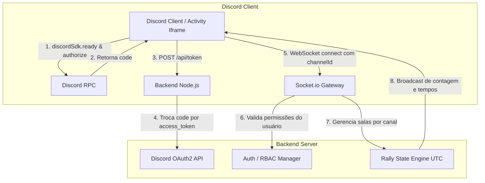

# 🚀 Plano de Arquitetura e Implementação: Rally Sync (Discord Activity)

Documento técnico e plano estruturado para a implementação da ferramenta de sincronização de rallies como uma **Discord Activity** interativa em tempo real.

---

## 1. 🧠 Brainstorm: Arquitetura da Solução

### Contexto
O objetivo é criar uma aplicação embutida (`<iframe>` no cliente Discord para Desktop e Mobile) compartilhada em tempo real entre membros de um canal de voz/texto. 
- **Coordenador:** Identificado por permissão (ex: *Gerenciar Mensagens*) ou cargo configurado. Único autorizado a cadastrar marchas, alterar parâmetros, disparar/reiniciar a contagem e limpar a lista.
- **Espectadores:** Acompanham o relógio UTC central, a contagem regressiva e os alertas visuais/sonoros para efetuar a saída de suas tropas no segundo exato.
- **Isolamento por Canal:** Sessões independentes por canal no servidor Discord.

---

### Opções Arquiteturais Avaliadas

#### Opção A: Fullstack Monolítico Leve (Node.js + Express + Socket.io + Vite/React em Monorepo) — [ESCOLHIDA]
*Arquitetura recomendada pela documentação oficial do Discord Embedded App SDK.*
O backend Express gerencia os endpoints OAuth2 (`/api/token`), a autorização e as salas de WebSocket via Socket.io. O mesmo serviço entrega o build estático do cliente React em produção.

✅ **Prós:**
- Arquitetura nativa e recomendada pela documentação do Discord.
- Sem problemas de CORS ou múltiplos deploys: uma única porta/serviço cuida de WebSocket, API REST e Frontend.
- Compartilhamento direto de tipos TypeScript entre cliente e servidor (estado da sala, eventos de socket).
- Baixo consumo de recursos e fácil deploy (Railway, Render, VPS ou Cloudflare Tunnels).

❌ **Contras:**
- Estado volátil em memória (reiniciar o servidor reinicia contagens ativas, contornável com persistência simples caso necessário).

📊 **Esforço:** Médio

---

#### Opção B: Backend Dedicado Fastify + Frontend SPA Desacoplado
Backend robusto em Fastify + Socket.io separado do frontend React/Tailwind em CDN.

✅ **Prós:**
- Separação total de código e responsabilidades.
- Frontend servido via CDN de alta performance.

❌ **Contras:**
- Complexidade adicional no Content Security Policy (CSP) e mapeamento de URLs exigido pelo Discord Developer Portal.
- Manutenção de dois domínios e setups separados.

📊 **Esforço:** Alto

---

#### Opção C: Frontend Estático + Realtime Serverless (PartyKit / Supabase)
Utilizar serviços gerenciados de WebSockets com funções serverless para troca de token.

✅ **Prós:**
- Pouca infraestrutura própria para manter.
- Escalabilidade gerenciada por terceiros.

❌ **Contras:**
- Custos adicionais ou limitações de planos gratuitos.
- Dificuldade para validar de forma autoritativa no servidor se o usuário tem permissão de Coordenador no Discord.

📊 **Esforço:** Médio-Alto

---

## 2. 📐 Diagrama de Fluxo e Arquitetura



---

## 3. 🗺️ Plano Detalhado de Implementação por Fases

### Fase 1: Setup do Discord Developer Portal e Ambiente Local
- [ ] Criar aplicação no [Discord Developer Portal](https://discord.com/developers/applications).
- [ ] Obter `DISCORD_CLIENT_ID` e `DISCORD_CLIENT_SECRET`.
- [ ] Habilitar o recurso de **Activity** e configurar ícones e nomes da atividade.
- [ ] Configurar túnel HTTPS para desenvolvimento local (`cloudflared` ou `ngrok`).
- [ ] Estruturar o monorepo do projeto:
  ```text
  rally_sync/
  ├── client/        # Vite + React + Tailwind CSS + @discord/embedded-app-sdk
  ├── server/        # Node.js + Express + Socket.io
  └── package.json   # Scripts unificados de dev, build e run
  ```

---

### Fase 2: Autenticação e Verificação de Permissões (RBAC)
- [ ] **Fluxo OAuth2 do Embedded App SDK:**
  - Inicializar `DiscordSDK(CLIENT_ID)` e aguardar `discordSdk.ready()`.
  - Executar `discordSdk.commands.authorize()` com escopos: `identify`, `guilds`, `guilds.members.read`.
  - Criar rota `/api/token` no backend para trocar o `code` pelo `access_token` via Discord OAuth2.
  - Finalizar com `discordSdk.commands.authenticate({ access_token })`.
- [ ] **Validação de Papel (Coordenador vs Espectador):**
  - Obter `channelId` e `guildId` do contexto da Activity.
  - Verificar se o usuário possui permissão de *Gerenciar Mensagens* ou cargo de `@Líder de Rally` (via `discordSdk.commands.getChannelPermissions()` ou validação direta via Bot API no backend).
  - Enviar flag `isCoordinator` segura para controle de interface.

---

### Fase 3: Motor de Sincronia e Cálculo (Backend)
- [ ] **Gerenciamento de Salas Isoladas por Canal (`channelId`):**
  - Estado da sala mantido no servidor:
    ```typescript
    interface RallyPlayer {
      id: string;
      name: string;
      marchTimeSeconds: number;
      departureTimeUtc?: number;
    }

    interface RallyRoomState {
      rallyDuration: 300 | 600;      // 5 ou 10 minutos (em segundos)
      prepWindow: 10 | 20 | 60;       // Janela de preparação (em segundos)
      status: 'idle' | 'countdown' | 'in_march' | 'finished';
      startTimeUtc: number | null;    // Timestamp UTC do disparo
      targetImpactTimeUtc: number | null; // Instante em que todos batem no alvo
      players: RallyPlayer[];
    }
    ```
- [ ] **Algoritmo de Cálculo Instantâneo (UTC):**
  1. $T_{\text{atual}} = \text{Date.now() (UTC)}$.
  2. Identificar a maior marcha da lista: $M_{\text{max}}$.
  3. Saída do 1º jogador = $T_{\text{atual}} + (\text{prepWindow} \times 1000)$.
  4. Horário de impacto = Saída do 1º jogador $+ ((\text{rallyDuration} + M_{\text{max}}) \times 1000)$.
  5. Para cada jogador $i$: $\text{Saída}_i = \text{Horário de impacto} - ((\text{rallyDuration} + M_i) \times 1000)$.
  6. Ordenar lista decrescente pelo tempo de marcha ($M$).
- [ ] **Sincronização de Relógio (Time Drift):**
  - Envio periódico de timestamp do servidor para calibrar o relógio dos clientes, garantindo que o cronômetro bata no mesmo milissegundo independente do relógio do SO do usuário.
- [ ] **Controle de Dados:**
  - Inserção/atualização de jogador (se o nome já existir, atualiza o tempo sem duplicar).
  - Reinício de contagem (mantém os mesmos jogadores).
  - Limpar lista (reseta completamente a lista de jogadores da sala).

---

### Fase 4: Interface do Usuário (Frontend React + Tailwind)
- [ ] **Design Responsivo:** Adaptável tanto para visualização em miniatura/mobile quanto janela cheia no desktop.
- [ ] **Visão do Coordenador:**
  - Controles de duração (`5m` / `10m`) e preparo (`10s` / `20s` / `1m`).
  - Input rápido com parser flexível de tempo (aceita `30`, `35s`, `01:15`).
  - Botões dedicados: *Iniciar / Reiniciar Sequência*, *Repetir com Mesmos Jogadores*, *Limpar Lista*.
- [ ] **Visão Comum (Espectadores e Coordenador):**
  - Relógio UTC global em tempo real no cabeçalho.
  - Cronômetro regressivo com destaque visual animado.
  - Lista ordenada de partidas exibindo Nome, Tempo de Marcha e Horário Exato UTC.
  - Alerta visual progressivo (amarelo nos últimos 3 segundos, verde no instante zero).
  - Alerta sonoro integrado via Web Audio API (bips suaves sem dependência de assets pesados).

---

### Fase 5: Testes e Validação
- [ ] Teste multi-usuário com 2 contas em canais reais do Discord.
- [ ] Teste de canais simultâneos para validar o isolamento completo de salas.
- [ ] Teste de reconexão de socket em caso de oscilação de rede.
- [ ] Validação de permissões e tentativas de injeção de eventos não autorizados.
